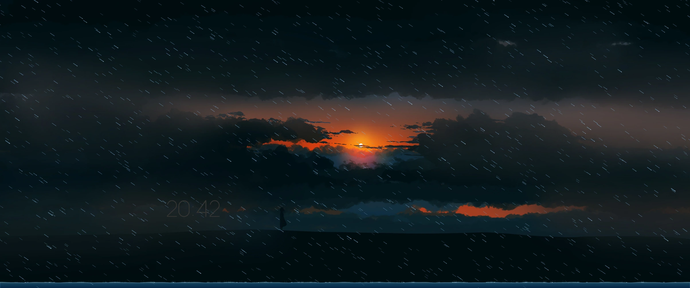
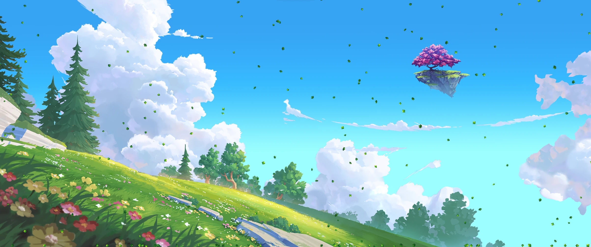
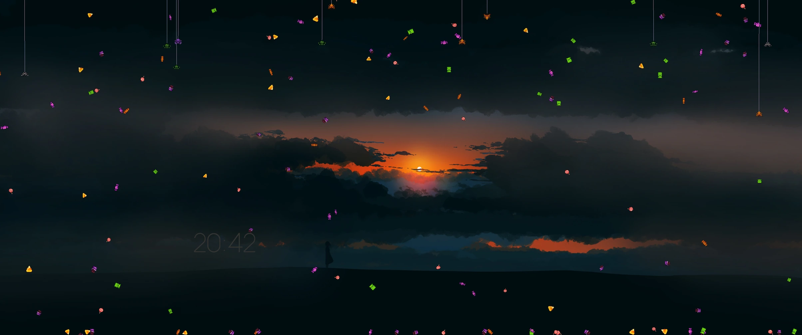

# Ultimate Desktop Effects 1.0.5

[English](README.md) · **Deutsch** · [Русский](README.ru.md)

Schnee bleibt auf Fenstern liegen, Regen sammelt sich an der Taskleiste, und
Blätter treiben über den Desktop. Im Halloween-Modus fallen Pixel-Süßigkeiten,
und Spinnen seilen sich an Fäden ab. Alle vier Effekte lassen sich im
Einstellungsfenster oder über das Menü im Infobereich wechseln.

Jeder Effekt hat eigene Einstellungen. Sprache, Installation, das Symbol im
Infobereich und der Windows-Autostart werden für die gesamte App verwaltet.

## Änderungen in 1.0.5

Das neue App-Symbol hebt das UE-Monogramm und die Lichterkette hervor. Es ist auch im kleinen Infobereich gut erkennbar.

## Änderungen in 1.0.4

Das App-Symbol hat jetzt einen transparenten Hintergrund.

## Änderungen in 1.0.3

Das Infobereichsmenü enthält **Nach Updates suchen**. Die App prüft GitHub im Hintergrund, verifiziert den Download per SHA-256 und startet nach der Bestätigung neu. Bei Versionen vor 1.0.3 ist einmalig die manuelle Installation einer aktuellen Version erforderlich.

## Änderungen in 1.0.2

- Das Infobereichssymbol kann die Einstellungen und das Schnellmenü auch öffnen, wenn WinDock das ältere Windows-Klickformat sendet.
- Im Modus „Hinter Fenstern“ wird der Schnee an den Fensterkanten abgeschnitten. Bei einem maximierten Fenster bleibt der gesamte betroffene Bildschirm frei von Schnee.

## Herunterladen und starten

| Datei | Verwendung |
| --- | --- |
| [`Ultimate-Desktop-Effects-x64.exe`](https://github.com/povargg/Ultimate-Desktop-Effects/releases/latest/download/Ultimate-Desktop-Effects-x64.exe) | Doppelklick öffnet die einmalige Installation. Danach über das Startmenü oder die installierte EXE starten. |
| [`Ultimate-Desktop-Effects-Portable.exe`](https://github.com/povargg/Ultimate-Desktop-Effects/releases/latest/download/Ultimate-Desktop-Effects-Portable.exe) | Per Doppelklick sofort starten. Der Dateiname muss `Portable` enthalten. |
| [`Ultimate-Desktop-Effects-Source.zip`](https://github.com/povargg/Ultimate-Desktop-Effects/releases/latest/download/Ultimate-Desktop-Effects-Source.zip) | Vollständiger C++17-Quellcode, Pixelgrafiken, Tests, Buildskripte und Dokumentation. |

Windows 10 ab Version 1703 und Windows 11, **64 Bit**, mit Direct3D-11-Unterstützung. Es werden keine zusätzlichen .NET-, Python- oder Visual-C++-Laufzeitpakete zum Ausführen benötigt.

Die Installation erfolgt benutzerbezogen nach `%LOCALAPPDATA%\Programs\UltimateDesktopEffects`, ohne Administratorrechte. Optional können eine Desktop-Verknüpfung und ein Windows-Autostart eingerichtet werden. Einstellungen liegen in `%APPDATA%\UltimateDesktopEffects\settings.ini`, auch bei portablem Start.

Das Symbol im Infobereich öffnet mit **Linksklick** die Einstellungen, mit **Rechtsklick** das Schnellmenü. Eine zweite Instanz öffnet die Einstellungen der bereits laufenden App.

## Zwischen den vier Effekten wechseln

Die gemeinsame Auswahl **Schnee / Regen / Blätter / Halloween** befindet sich oben im Hauptfenster, in den zusätzlichen Einstellungsfenstern und im Schnellmenü. Beim Wechsel werden die passenden Einstellungen angezeigt. Eine weitere Installation ist dafür nicht erforderlich.

Für jeden Effekt lassen sich Dichte, Geschwindigkeit, Wind, Ansammlungen,
Bildrate und die besonderen Optionen getrennt einstellen. Beim Wechsel
pausiert die bisherige Szene mit ihren Partikeln und Ansammlungen. Bei der
Rückkehr läuft sie an derselben Stelle weiter. Berechnet und gezeichnet wird
jeweils die ausgewählte Szene.

Beim Beenden speichert die App die Einstellungen und den zuletzt ausgewählten
Effekt. Nach einem Programmneustart bauen sich die Ansammlungen neu auf.

| Schnee | Regen |
| :---: | :---: |
|  |  |

| Fallende Blätter | Halloween |
| :---: | :---: |
|  |  |

| Effekt | Erhaltene Funktionen |
| --- | --- |
| Schnee, ursprünglich LayerSnow / „SnowLayer“ | Weiche Flocken und vier Kristallformen fallen mit dem Wind und sammeln sich auf Fenstern und der Taskleiste. Der Schnee kann schmelzen, abrutschen oder abgeschüttelt werden. Vier Voreinstellungen stehen zur Auswahl. |
| Regen | Kleine und große Tropfen spritzen auf und bilden Wasserflächen mit Wellen, die nach und nach verdunsten. Es gibt vier Regen-Voreinstellungen. Blitze und das Aufleuchten des Bildschirms lassen sich getrennt einschalten. |
| Blätter | Zur Auswahl stehen Sakura-Blüten, grüne Frühlings- und Sommerblätter sowie Herbstlaub. Die jeweils vier Pixelvarianten schwingen und taumeln beim Fallen. In Ansammlungen überlappen sie sich, wobei die Motivfläche vollständig gezeichnet wird. |
| Halloween | Es gibt sechs Pixel-Süßigkeiten und vier Spinnentypen. Süßigkeiten und Spinnen können getrennt oder zusammen angezeigt werden. Die Spinnen seilen sich langsam ab, halten manchmal auf halber Höhe an und klettern nach einer Pause mit gleicher Wahrscheinlichkeit wieder hoch oder lassen sich fallen. Ein Klick auf einen sichtbaren Faden schneidet ihn durch. |

Die bisherigen Funktionen für vor/hinter Fenstern, Fenster- und Taskleistenansammlungen, Mauswind, Wegfegen mit dem Cursor, Abschütteln, Vollbildpause, Deckkraft und Bildrate bleiben beim jeweiligen Effekt erhalten. Nur Halloween wertet Fadentreffer aus. Unsichtbare oder durch Vordergrundfenster verdeckte Fäden sind nicht anklickbar. Normale Klicks werden weitergereicht; ein erfolgreicher Schnitt verbraucht den betreffenden Linksklick.

## Sprache und vorhandene Einstellungen

Alle Oberflächen bieten **Deutsch, Englisch, Russisch, Ukrainisch und Rumänisch**. Die Sprache gilt für die gesamte Anwendung; auch der Schneemodus besitzt jetzt Deutsch als fünfte Sprache. Beide Autoren stehen im Interface und Installer.

Beim ersten Start werden vorhandene Effektparameter aus den bisherigen Ordnern `LayerSnow` beziehungsweise `SnowLayer`, `LayerRain`, `LayerLeaves` und `LayerHalloween` gelesen, sofern noch keine neue Konfigurationsdatei besteht. Die neuen Profile werden anschließend gemeinsam gespeichert. Bereits vorhandene Einzelversionen und deren Dateien bleiben eigenständig. Für die gemeinsame Anwendung genügt es, Ultimate Desktop Effects zu starten; frühere Einzelversionen können separat beendet oder deinstalliert werden.

## Leistung

Es gibt einen Prozess, ein Overlay, eine Desktop-Erfassung und einen aktiven Effekt. Die ursprünglichen neun Dateien mit Simulationslogik wurden unverändert in eigene C++-Namensräume übernommen. Inaktive Effekte behalten ihren begrenzten CPU-Zustand, führen aber keine Simulationsschritte aus. Beim Wechsel werden die GPU-Ressourcen der bisherigen Darstellung und die geschlossenen Einstellungsfenster freigegeben. Die ursprünglichen Grenzen für Partikel, Stapel und Spinnen sowie die reduzierte Bildrate bei statischen Ansammlungen bleiben erhalten.

Ein nativer CPU-Vergleich über jeweils 3.600 Simulationsschritte lag für die gemeinsame Steuerung bei etwa **0,96–1,03 ×** dem Aufwand direkter Aufrufe derselben Routinen. Das ist ein Linux-Simulationstest, kein Windows-GPU-Benchmark und keine allgemeine Prozentangabe zur CPU-Auslastung. Details: [docs/VALIDIERUNG.md](docs/VALIDIERUNG.md).

## Bauen

### MinGW-w64, auch unter Linux

```sh
python3 build_mingw.py --cxx x86_64-w64-mingw32-g++-posix
```

### Windows mit Visual Studio

Visual Studio 2022 Build Tools mit C++-Desktopentwicklung und Windows SDK installieren, dann `build.bat` ausführen. Dieses alternative Buildskript ist enthalten; der ausgelieferte Build wurde tatsächlich mit MinGW-w64 kompiliert.

Ausgaben: `dist/Ultimate-Desktop-Effects-x64.exe`, `dist/Ultimate-Desktop-Effects-Portable.exe`, `dist/Ultimate-Desktop-Effects-Uninstall.exe`. Alle drei enthalten dieselben Bytes; Dateiname und Startparameter steuern den Betriebsmodus.

| Parameter | Wirkung |
| --- | --- |
| `/portable` | Direkt starten, ohne Installationsdialog |
| `/uninstall` | Deinstallationsdialog |
| `/uninstall /quiet` | Installation und Einstellungen ohne weiteren Dialog entfernen |
| `/autostart` | Von Windows automatisch gestartete Kopie |

Zum Deinstallieren stehen „Installierte Apps“, die Startmenü-Verknüpfung und `uninstall.exe` im Installationsordner zur Verfügung. Das Entfernen der Einstellungen ist im normalen Dialog wählbar.

## Tests und Prüfgrenzen

```sh
sh run-tests.sh
python3 tests/release_checks.py
```

Der native Testlauf benötigt einen C++17-Compiler mit AddressSanitizer und UndefinedBehaviorSanitizer. Die Paketprüfungen benötigen Python 3, Pillow und zuvor kompilierte Windows-EXEs. **Ergebnis des Basisstands 1.0.0: 200 Prüfungen bestanden, 0 fehlgeschlagen.** Davon sind 185 echte C++-Simulationstests und 15 Grafik-, Quellcodeintegrations- und Paketprüfungen. Ausgaben liegen in [docs/testprotokoll.txt](docs/testprotokoll.txt).

Die Windows-EXE wurde erfolgreich ohne Compilerwarnungen erstellt. In der verfügbaren Linux-Umgebung konnten die Windows-Oberfläche, tatsächliche Maus-Hook-Zustellung, Installation und GPU-Komposition nicht praktisch ausgeführt werden. Die EXE ist nicht digital signiert. Die Offline-Vorschauen zeigen echte Simulationsdaten mit vereinfachter Zeichnung und sind keine Windows-Bildschirmaufnahmen.

## Quellcode und Herkunft

Das Windows-Overlay und der ursprüngliche Schneeeffekt stammen aus
[LayerSnow](https://github.com/flipkips/desktop-snow-overlay) von [flipkips](https://github.com/flipkips).
[povargg](https://github.com/povargg) entwickelte die Effekte für Regen, Blätter
und Halloween und fasste sie mit dem Schneeeffekt in einer Anwendung zusammen.

- [docs/ARCHITEKTUR.md](docs/ARCHITEKTUR.md): gemeinsamer Host, Effektwechsel, Profile und Ressourcennutzung.
- [docs/VALIDIERUNG.md](docs/VALIDIERUNG.md): Prüffälle, Leistungswerte und Grenzen.
- `docs/source-provenance.json`: Ausgangsarchive, ursprünglicher Git-Commit und Vergleichswerte der Simulationsdateien.
- `res/leaves` und `res/halloween`: alle Pixelgrafiken einschließlich Generierungsvorlagen und Prompts.
- [LICENSE](LICENSE) und `licenses/`: MIT sowie Laufzeithinweise.

Die Anwendung arbeitet lokal. Es gibt keine Konten, Telemetrie oder Downloads von Effekten zur Laufzeit. Die GitHub-Links werden nur auf ausdrücklichen Klick im Browser geöffnet.
