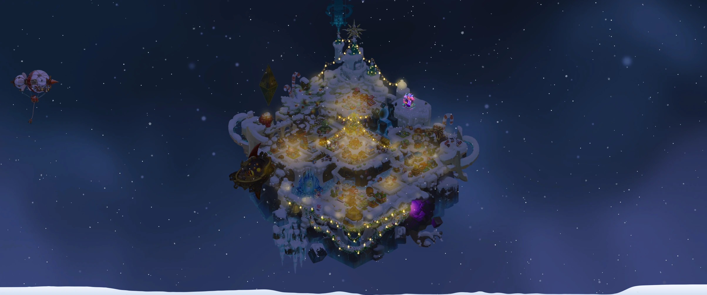
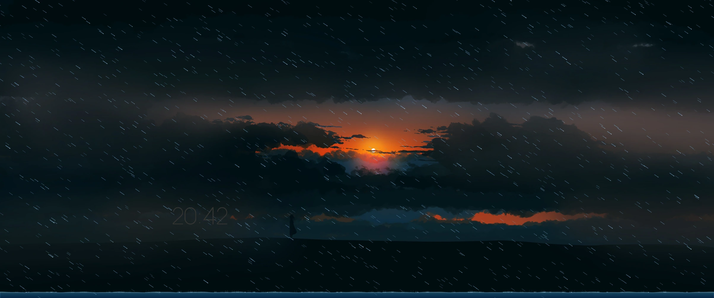
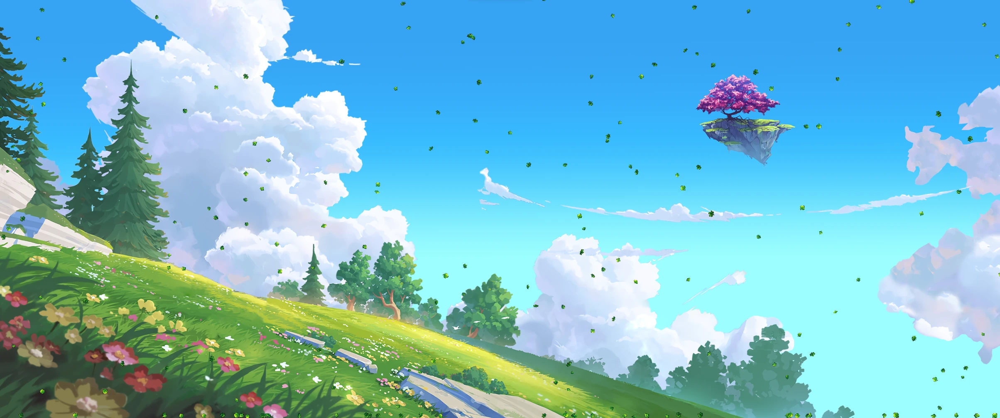
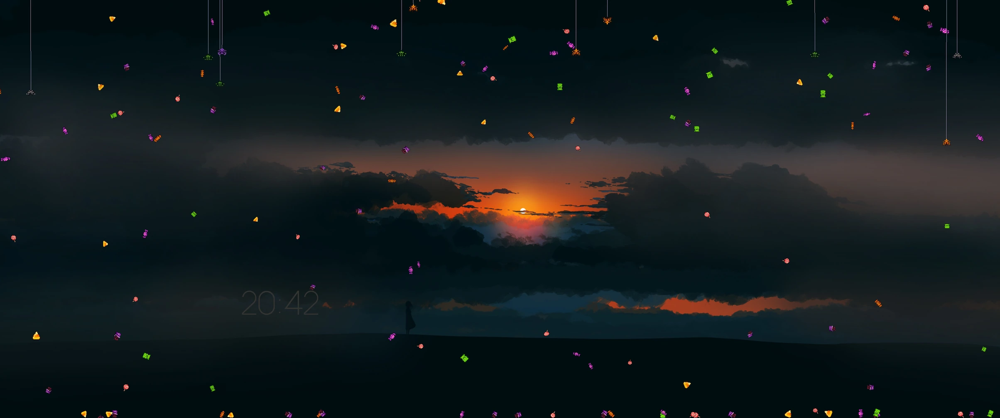

<div align="center">


# Ultimate Desktop Effects

**Снег, дождь, листопад и Хеллоуин на рабочем столе Windows.**

[**Скачать для Windows**](https://github.com/povargg/Ultimate-Desktop-Effects/releases/latest/download/Ultimate-Desktop-Effects-x64.exe) · [**Портативная версия**](https://github.com/povargg/Ultimate-Desktop-Effects/releases/latest/download/Ultimate-Desktop-Effects-Portable.exe) · [**Все релизы**](https://github.com/povargg/Ultimate-Desktop-Effects/releases)

[English](README.md) · [Deutsch](README.de.md) · **Русский**

Windows 10 / 11 · x64 · C++17 · лицензия MIT

</div>

## Что умеет приложение

Снег ложится прямо на окна, дождь собирается у панели задач, а листья
падают по всему экрану. В режиме Хеллоуина падают пиксельные конфеты и
спускаются пауки на нитях. Между всеми четырьмя эффектами можно переключаться
в настройках или через меню в трее.

У каждого эффекта свои настройки. При переключении сцена встаёт на паузу
вместе с частицами и тем, что уже успело накопиться. Если вернуться к этому
эффекту, сцена продолжится с того же места. Отрисовывается только выбранный
эффект.

| Снег | Дождь |
| :---: | :---: |
|  |  |

| Листопад | Хеллоуин |
| :---: | :---: |
|  |  |

## Четыре эффекта

| Эффект | Что происходит |
| --- | --- |
| **Снег** | Снежинки с четырьмя формами кристаллов летят по ветру и собираются на окнах и панели задач. Сугробы могут таять и соскальзывать комками. Есть четыре готовых настройки снегопада. |
| **Дождь** | Капли разбрызгиваются и собираются в лужи с волнами, которые со временем испаряются. Можно включить молнии, настроить их ветвление и яркость, а вспышку экрана включать отдельно. |
| **Листья** | Можно выбрать розовые лепестки сакуры, зелёные весенние и летние листья или жёлтые, оранжевые и красные осенние. У каждого типа по четыре варианта. Они раскачиваются, переворачиваются и ложатся плотными слоями. |
| **Хеллоуин** | В этом режиме есть шесть видов пиксельных конфет и четыре вида пауков. Можно оставить только конфеты, только пауков или включить всё сразу. Пауки спускаются на нитях и иногда останавливаются на полпути. После паузы паук с равной вероятностью полезет обратно или упадёт. Видимую нить можно перерезать щелчком. |

### Общие настройки

- Эффекты можно вывести поверх окон или за ними.
- Частицы могут накапливаться на верхних краях окон и на панели задач.
- Для каждого эффекта доступны свои настройки плотности, скорости падения, ветра, размера, высоты скоплений, непрозрачности и частоты кадров.
- Скопления можно смахнуть курсором, стряхнуть или очистить.
- Оверлей можно приостановить и скрыть в полноэкранных приложениях и играх.
- Поддерживаются несколько мониторов с разным масштабом.
- Доступны автозапуск вместе с Windows и светлая и тёмная темы окна настроек.
- Интерфейс доступен на русском, английском, немецком, украинском и румынском языках.

Графика листопада и Хеллоуина выполнена в пиксельном формате **16 × 16**.
Когда частицы оседают, они отрисовываются целиком, но сталкиваются по
меньшей области. Благодаря этому они перекрываются и ложатся плотнее.

## Загрузка

**Текущая версия 1.0.5 · Windows x64**

Начиная с версии 1.0.3, в меню в области уведомлений доступен пункт
**Проверить обновления**. Приложение проверяет GitHub в фоне, сверяет
контрольную сумму SHA-256 загруженного файла и перезапускается после
подтверждения установки. Для версий до 1.0.3 требуется один раз
установить текущий выпуск вручную.

| Файл | Назначение |
| --- | --- |
| [**Ultimate-Desktop-Effects-x64.exe**](https://github.com/povargg/Ultimate-Desktop-Effects/releases/latest/download/Ultimate-Desktop-Effects-x64.exe) | Установщик. После установки приложение запускается из меню «Пуск». |
| [**Ultimate-Desktop-Effects-Portable.exe**](https://github.com/povargg/Ultimate-Desktop-Effects/releases/latest/download/Ultimate-Desktop-Effects-Portable.exe) | Прямой запуск без установки. В имени файла должно присутствовать `Portable`. |
| [**ZIP с исходным кодом**](https://github.com/povargg/Ultimate-Desktop-Effects/releases/latest/download/Ultimate-Desktop-Effects-Source.zip) | Исходный код на C++, ресурсы, сценарии сборки, тесты и документация. |

Требуется 64-разрядная версия **Windows 10 (1703 или новее) либо Windows 11**
с поддержкой Direct3D 11. Среда выполнения C++ включена в исполняемый файл.
Запуск не требует установки .NET, Python или отдельного пакета Visual C++.

Исполняемые файлы релиза распространяются без цифровой подписи.

## Первый запуск

1. Загрузить и запустить установщик или портативный файл.
2. При использовании установщика завершить установку от имени текущего пользователя. Права администратора не требуются.
3. Найти значок **UE** в области уведомлений.
4. Нажать на него левой кнопкой мыши для открытия настроек или правой для открытия меню.
5. Выбрать **Снег**, **Дождь**, **Листья** или **Хеллоуин** в верхней части окна.

Дополнительные параметры дождя доступны в его настройках погоды. Для
листопада и Хеллоуина есть отдельные окна оформления. В настройках
Хеллоуина можно отключить перерезание нитей или изменить допустимое
расстояние от щелчка до нити.

## Установка и хранение настроек

По умолчанию приложение устанавливается в следующий каталог.

```text
%LOCALAPPDATA%\Programs\UltimateDesktopEffects
```

Настройки, в том числе при портативном запуске, хранятся в этом файле.

```text
%APPDATA%\UltimateDesktopEffects\settings.ini
```

При первом запуске можно импортировать параметры из каталогов прежних
эффектов `LayerSnow` или `SnowLayer`, `LayerRain`, `LayerLeaves` и
`LayerHalloween`. Новые профили хранятся в Ultimate Desktop Effects. Язык
интерфейса и автозапуск общие, а параметры каждого эффекта независимы.

Сцены и скопления сохраняются в памяти при переключении эффектов. Настройки
и последний выбранный эффект сохраняются между запусками. После перезапуска
сцена отрисовывается заново.

Удаление доступно в разделе Windows «Установленные приложения», через ярлык
в меню «Пуск» или файл `uninstall.exe` в каталоге установки. В обычном
диалоге удаления можно выбрать, сохранять ли настройки.

| Параметр запуска | Действие |
| --- | --- |
| `/portable` | Запуск без открытия установщика. |
| `/uninstall` | Открытие диалога удаления. |
| `/uninstall /quiet` | Удаление приложения и настроек без диалога. |
| `/autostart` | Запуск в режиме автозапуска Windows. |

## Отрисовка и производительность

Приложение написано на **C++17** с использованием **Direct3D 11, Direct2D,
DirectWrite и DirectComposition**. Работают один процесс, один оверлей и
одна активная симуляция. Неактивные эффекты сохраняют ограниченное состояние
в памяти. При переключении освобождаются графические ресурсы прежнего
эффекта и закрытых окон настроек.

Лимиты частиц, кеш скоплений, обновление по событиям окон и снижение частоты
кадров для статических сцен унаследованы от отдельных эффектов. В тесте на
машине сборки время работы общего диспетчера отличалось от прямых вызовов
симуляции на несколько процентов. Замер относится к симуляции на CPU.
Результаты и границы измерений приведены в [отчёте о проверке](docs/VALIDIERUNG.md).

Эффекты работают локально. Учётные записи, телеметрия и загрузка эффектов
во время работы не используются. Ссылки на GitHub открываются в браузере
по щелчку.

## Сборка из исходного кода

Графика эффектов и значок Windows входят в репозиторий. Для сборки
достаточно поставляемых ресурсов.

### MinGW-w64 на Windows или Linux

```sh
python3 build_mingw.py --cxx x86_64-w64-mingw32-g++-posix
```

Опубликованный исполняемый файл собран с помощью MinGW-w64 со статической
компоновкой среды выполнения C++.

### Visual Studio на Windows

Для сборки требуются Visual Studio 2022 Build Tools с компонентом
«Разработка классических приложений на C++» и Windows SDK.

```bat
build.bat
```

При использовании MinGW-w64 непосредственно в Windows применяется команда
`python build_mingw.py --cxx g++`.

Результаты сборки помещаются в `dist/`. Установщик, портативный файл и
деинсталлятор имеют одинаковое содержимое. Режим выбирается по имени
файла или параметрам запуска.

## Тесты и результаты проверок

```sh
sh run-tests.sh
python3 tests/release_checks.py
```

Проверка обработки событий значка в области уведомлений выполняется в Windows
с MinGW-w64 после создания каталога `build/`.

```powershell
g++ -std=c++17 tests/tray_tests.cpp -o build/tray_tests.exe
.\build\tray_tests.exe
```

Для тестов симуляции требуется компилятор C++17 с AddressSanitizer и
UndefinedBehaviorSanitizer. Для проверок релиза нужны Python 3, Pillow и
собранные исполняемые файлы Windows.

- В версии **1.0.0** прошли 185 тестов симуляции на C++ и 15 проверок ресурсов, интеграции и пакета.
- В версии **1.0.1** прошли 15 проверок релиза и четыре проверки текстов и значка. Логика симуляции осталась прежней.
- В версии **1.0.2** прошли 188 тестов симуляции и настроек, 11 тестов обработки событий значка в области уведомлений и 15 проверок пакета. На изолированном рабочем столе Windows проверили, что оба формата событий открывают окна приложения, а рендерер обрезает снег при развёрнутом окне.
- Тесты охватывают переключение эффектов, независимые профили, скопления, перемещение окон, разный масштаб экранов, молнии, состояния пауков и перерезание нитей.

Для проверки 1.0.2 на изолированном рабочем столе тесты отправляли
приложению те же сообщения, что оболочка Windows и WinDock. Статические
проверки релиза охватывали выбор режима установщика и регистрацию
обработчика мыши.

[Отчёт о проверках](docs/VALIDIERUNG.md) · [Протокол базовой версии](docs/testprotokoll.txt) · [Изменения 1.0.1](docs/PATCH-1.0.1.md) · [Протокол 1.0.1](docs/patch-1.0.1-testprotokoll.txt)

## Структура проекта

| Каталог | Содержимое |
| --- | --- |
| `src/` | Приложение, настройки, диспетчер отрисовки и модули эффектов. |
| `res/` | Ресурсы Windows, пиксельная графика и значок приложения. |
| `tests/` | Тесты симуляции и проверки релиза. |
| `tools/` | Подготовка ресурсов, локальные предпросмотры и проверочные инструменты. |
| `docs/` | Архитектура, происхождение, результаты проверок и изображения. |
| `licenses/` | Уведомления о лицензиях среды выполнения. |

## Авторы и лицензия

[flipkips](https://github.com/flipkips) разработал
[LayerSnow](https://github.com/flipkips/desktop-snow-overlay), из которого
взяты исходный эффект снега, оверлей Windows и основа для определения окон,
работы с областью уведомлений и установки.

[povargg](https://github.com/povargg) разработал эффекты дождя, пиксельных
листьев и Хеллоуина и объединил их со снегом в Ultimate Desktop Effects.

Исходные сведения об авторах и уведомления об авторских правах сохранены.
Проект распространяется по [лицензии MIT](LICENSE). Уведомления о лицензиях
среды выполнения MinGW-w64 и GCC находятся в [`licenses/`](licenses/).
Запросы для генерации и исходники подготовки графики прилагаются к ресурсам.
